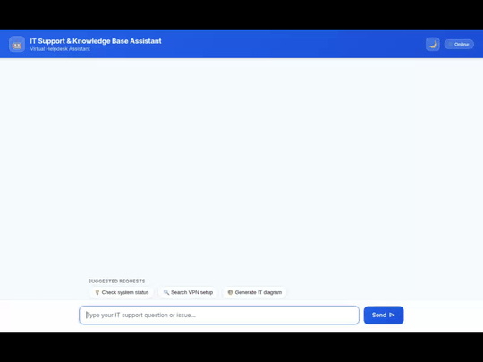

# IT Support & Knowledge Base Assistant

An intelligent, full-stack IT helpdesk agent built with the Google Agent Development Kit (ADK) and Gemini on Vertex AI. The agent helps enterprise employees troubleshoot technical issues, search knowledge base articles, manage IT support tickets in Cloud Firestore, monitor system infrastructure status, generate technical setup diagrams and videos, and render rich interactive A2UI cards.



---

## 🌟 Capabilities & Implemented Features

This project implements the following capabilities, fully integrated with Google Cloud services and the ADK framework:

### 1. 🧠 Memory Bank & Session Persistence
- **ADK PreloadMemoryTool**: Persists employee device specifications (OS, hardware model), recurring issues, and previous support tickets across chat sessions using the Vertex AI Reasoning Engine Memory Service.

### 2. 🗄️ Cloud Firestore Data Store Integration
- **Support Ticket Management**: Retrieve support tickets (`get_ticket`), list active user tickets (`list_tickets`), and create new support tickets (`create_ticket`) in the `support_tickets` Firestore collection.
- **Knowledge Base Search**: Query troubleshooting guides and IT solutions (`search_knowledge_base`) in the `knowledge_base` Firestore collection.
- **System Health Monitoring**: Run live operational status checks (`check_system_status`) on VPN, SSO, Email, and Printer infrastructure in the `system_status` Firestore collection.
- **Network IP Metadata Lookup**: Resolve network IP configurations (`lookup_network_ip`) in the `network_ip` Firestore collection.

### 3. 🎨 Multimedia Generation (Vertex AI & Cloud Storage)
- **Technical Diagram Generation (`generate_it_diagram`)**: Uses `gemini-3.1-flash-lite-image` in the `global` region to generate IT network and setup diagrams. Artifacts are saved to ADK tool context and uploaded directly to Google Cloud Storage (`gs://it-helpdesk-assets-67e0fb58/diagrams/`).
- **Technical Video Generation (`generate_it_video`)**: Uses `gemini-omni-flash-preview` in the `global` region to generate procedural motion graphics and video tutorials, uploaded directly to Google Cloud Storage (`gs://it-helpdesk-assets-67e0fb58/videos/`).

### 4. 🗺️ Google Maps Platform Tools
- **Geocoding & Facility Search**: `geocode_address` and `find_nearby_places` locate physical helpdesk centers and IT equipment pick-up locations using the Google Maps API.

### 5. 🐍 Secure Code Execution Sandbox
- **AgentEngineSandboxCodeExecutor**: Executes Python diagnostic scripts in a Cloud Reasoning Engine sandbox to analyze error logs, stack traces, and network metrics.

### 6. 📱 Interactive A2UI Card Protocol & FastAPI Proxy
- **A2UI Card Renderer**: Formats responses into structured A2UI cards (`Card`, `Column`, `Row`, `Text`, `Image`, `Divider`).
- **FastAPI Chat UI Proxy**: A minimal FastAPI backend (`frontend/main.py`) forwarding client chat requests over the A2A protocol. Features dark mode toggle, animated typing indicators, example prompts, and one-click copy buttons.

---

## 📁 Repository Structure

```
.
├── app/
│   ├── agent.py               # Root ADK agent configuration & model setup
│   ├── firestore_tools.py     # Firestore tools (tickets, KB, status, IP lookup)
│   ├── image_tools.py         # Gemini image generation & Cloud Storage upload
│   ├── video_tools.py         # Gemini Omni video generation & Cloud Storage upload
│   ├── maps_tools.py          # Google Maps geocoding and places lookup
│   └── app_utils/             # Memory service helpers & callback definitions
├── frontend/
│   ├── main.py                # FastAPI proxy server for A2A communication
│   ├── requirements.txt       # Frontend Python dependencies
│   ├── Dockerfile             # Container definition for Cloud Run deployment
│   └── static/
│       └── index.html         # Responsive Chat UI with A2UI card renderer & dark mode
├── agents-cli-manifest.yaml   # ADK Agent manifest
├── deployment_metadata.json   # Deployment target metadata
└── demo.gif                   # Looping video demo recording
```

---

## 🛠️ Local Setup & Run Instructions

### Prerequisites
- Python 3.11+
- Google Cloud SDK (`gcloud`) with access to Vertex AI, Firestore, and Cloud Storage

### 1. Set Up Environment Variables
Create a `.env` file in the project root:

```bash
GOOGLE_CLOUD_PROJECT=qwiklabs-gcp-01-67e0fb58e2a5
GOOGLE_CLOUD_LOCATION=us-east1
GOOGLE_GENAI_USE_VERTEXAI=true
GOOGLE_MAPS_API_KEY=your-google-maps-api-key
```

### 2. Install Dependencies
Install the required Python dependencies:

```bash
uv pip install -r frontend/requirements.txt
```

### 3. Run Local ADK Playground
Start the local ADK development playground:

```bash
uv run adk web . --port 8080 --reload_agents
```

### 4. Run the FastAPI Proxy & Chat UI
Alternatively, launch the FastAPI proxy server from the `frontend/` directory:

```bash
python frontend/main.py
```

Access the Chat UI by opening your web browser to port `8080` or `8000`.
